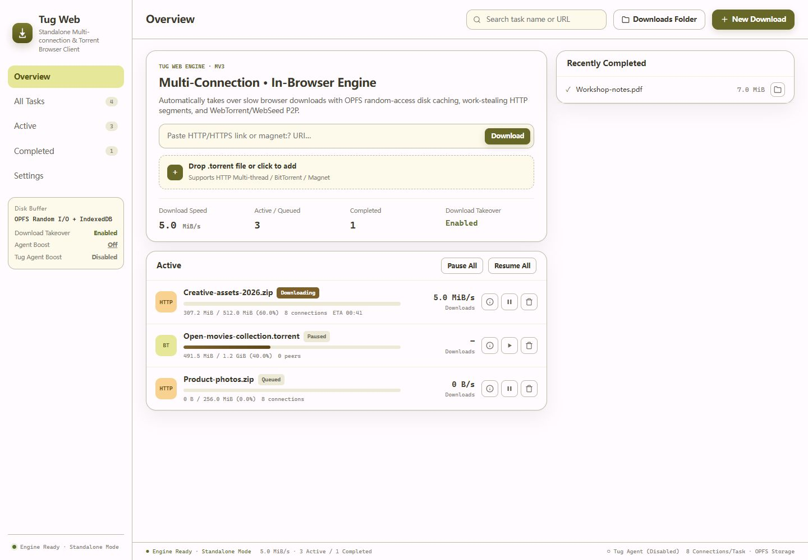
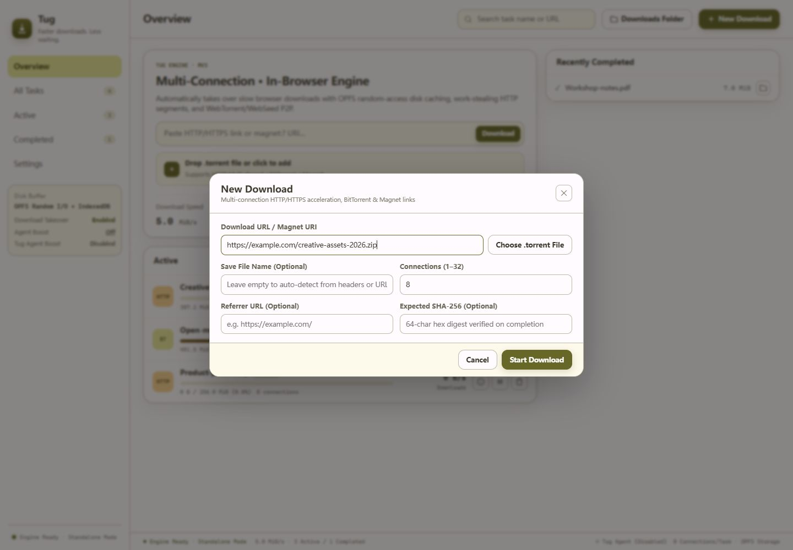
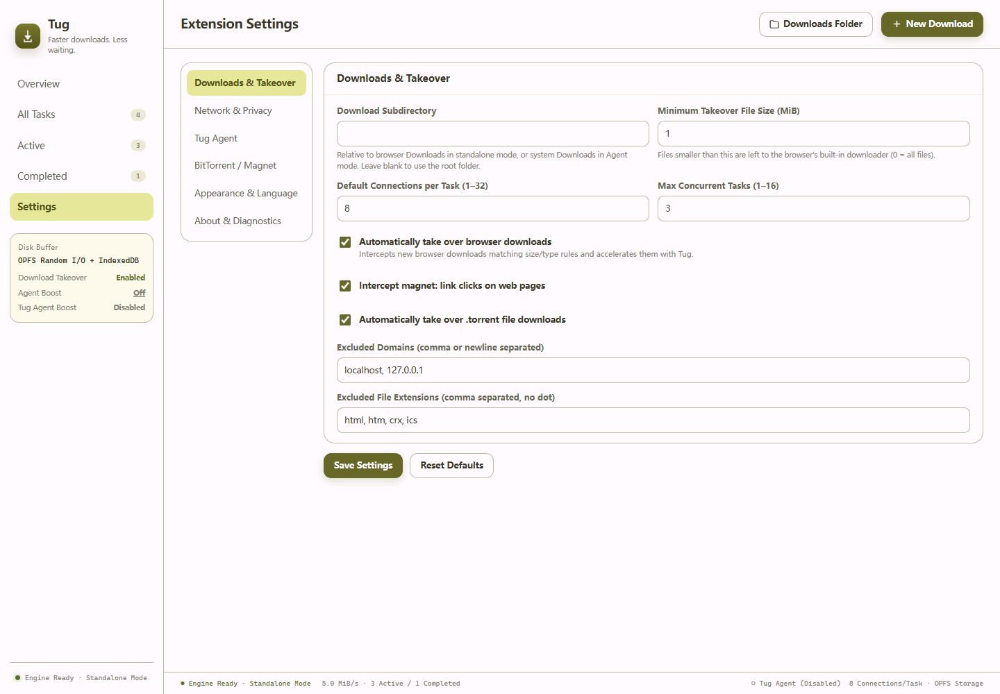

<h1 align="center">
   Tug Web
</h1>

<p align="center">Your browser download workspace · Multi-connection · Resume · BitTorrent / Magnet</p>
<p align="center">
  
  
  <a href="LICENSE"></a>
</p>
<p align="center"><a href="README.md">简体中文</a> · <b>English</b></p>
<p align="center"><a href="https://github.com/nanio-dev/Tug-Web/releases/tag/last">Latest release</a> · <a href="https://github.com/nanio-dev/Tug-Desktop">Windows</a> · <a href="https://github.com/nanio-dev/Tug-Android">Android</a></p>

Tug Web is an independent download extension for Chromium browsers. Manage HTTP/HTTPS downloads, paused tasks, torrents and magnet links in Chrome, Edge and compatible browsers. Browser downloads work without Tug Desktop.

## Download

| File | Purpose |
|---|---|
| [Browser extension CRX](https://github.com/nanio-dev/Tug-Web/releases/download/last/tug-web.crx) | Signed CRX3 package; installation depends on browser policy |
| [Tug Agent · Windows x64](https://github.com/nanio-dev/Tug-Web/releases/download/last/tug-agent.exe) | Optional; adds traditional BT connectivity and system file export/reveal |
| [Tug Agent · macOS](https://github.com/nanio-dev/Tug-Web/releases/download/last/tug-agent-macos-universal.zip) | Universal Intel / Apple Silicon app |
| [Tug Agent · Linux x64](https://github.com/nanio-dev/Tug-Web/releases/download/last/tug-agent-linux-x64.tar.gz) | Extract and run `sh install.sh`, without sudo |
| [Tug Agent · Linux ARM64](https://github.com/nanio-dev/Tug-Web/releases/download/last/tug-agent-linux-arm64.tar.gz) | Extract and run `sh install.sh`, without sudo |
| [Build manifest](https://github.com/nanio-dev/Tug-Web/releases/download/last/release.json) | Source commit, build time and file checksums |
| [SHA256SUMS.txt](https://github.com/nanio-dev/Tug-Web/releases/download/last/SHA256SUMS.txt) | Download checksums |

### Get started

1. Download the signed CRX and open your browser's extension management page.
2. Import it only where your browser supports manual CRX installation; browser and management policies apply.
3. Chrome on Windows/macOS restricts non-store extensions, usually requiring managed enterprise deployment. Developers can build from source and load `dist/extension/` using Developer mode.
4. Pin Tug Web to the toolbar. Add a link in the popup or open the dashboard to manage all downloads.

HTTP/HTTPS and compatible WebTorrent/WebSeed tasks can use browser-only mode. For traditional BT TCP/UDP/DHT peers or system file export/reveal, follow the extension's setup flow to enable the optional **Tug Agent companion component** on Windows, macOS or Linux.

On macOS, extract the archive and open `Tug Agent.app`. Developer ID signing/notarization is not configured; first launch may require approval in System Settings > Privacy & Security. On Linux, extract and run `sh install.sh` as your desktop user, without sudo. Native Chromium browser installations are supported; Snap/Flatpak native messaging bridges are not provided. Subsequent connections and the 120-second idle exit are automatic, with no login service installed.

Agent installs under `%LOCALAPPDATA%\TugAgent` on Windows, `~/Library/Application Support/TugAgent` on macOS, or `${XDG_DATA_HOME:-~/.local/share}/tug-agent` on Linux. Downloads use system Downloads (Linux prefers `xdg-user-dir DOWNLOAD`), without reading browser preferences. Uninstall removes the user installation and its native host manifests.

## Screenshots

| Download overview | Add a download |
|---|---|
|  |  |



## Features

- **Multi-connection HTTP/HTTPS** with configurable connections, parallel tasks and a global speed limit.
- **Validated resume** with pause, continue, retry, Range and ETag / Last-Modified checks; single-stream fallback when ranges are unsupported.
- **BitTorrent / Magnet** with torrent files, magnets, WebTorrent/WebSeed, selective files and piece verification; the companion component adds traditional BT connectivity.
- **Task management** with overview, all/active/completed lists, search, filters, sorting and bulk actions.
- **Browser integration** with download interception, context menus, magnet capture and temporary bypass.
- **Appearance and languages** with a toolbar popup, full dashboard, light/dark themes, Simplified Chinese, Traditional Chinese, English, Japanese and Korean.
- **Local storage** within the current browser profile. Clearing browser data can affect unfinished tasks; save important files first.

Effective concurrency depends on the browser network stack and server support. A configured connection count does not guarantee that many active connections to every source.

## Build from source

Requires Node.js 22+. Building the Windows companion also requires the Rust MSVC toolchain and C++ Build Tools.

```powershell
npm ci
npm run check
npm test
npm run build
```

On Windows, `build.bat` builds the extension into `dist/extension/` (`dist/` is also loadable).

**`packer.bat`** builds the production extension and companion component, then writes these files to `out/`:

| File | Contents |
|---|---|
| `tug-web.crx` | Signed CRX3 / Manifest V3 extension |
| `tug-agent.exe` | Windows Release companion component |
| `tug-agent-macos-universal.zip` | Universal macOS application |
| `tug-agent-linux-x64.tar.gz`, `tug-agent-linux-arm64.tar.gz` | Linux installers |
| `release.json` | Version, source commit, sizes and SHA-256 hashes |
| `SHA256SUMS.txt` | Plain-text checksums |

The signing key is created locally at `.local/tug-web-signing.pem` and reused to retain the extension ID. Back it up; it is excluded from Git and `out/`. Set `TUG_EXTENSION_SIGNING_KEY` to reuse an existing key.

Native GitHub Actions runners build and test Mac/Linux artifacts. Packaging requires an authenticated GitHub CLI and downloads the successful build matching the Agent source commit; missing/failed builds stop publication. Build locally on Mac/Linux with `sh agent/build.sh`. The full publish pipeline is `web/push.bat --no-pause`.

Use `--no-pause` for command-line runs. Any failure returns a nonzero exit code. Packages exclude internal docs, website source, screenshots and test resources. Reload the extension after an update, and keep the companion component current.

## Development and feedback

| Directory | Contents |
|---|---|
| `src/` | Extension UI, browser integration and download engines |
| `agent/` | Windows / macOS / Linux companion source |
| `public/` | Runtime assets and public screenshots/materials |
| `scripts/`, `tests/` | Build, test and verification tools |

```powershell
npm run test:browser
npm run test:agent
```

Found a problem? Open an [issue](https://github.com/nanio-dev/Tug-Web/issues).

## License

[Apache License 2.0](LICENSE).
