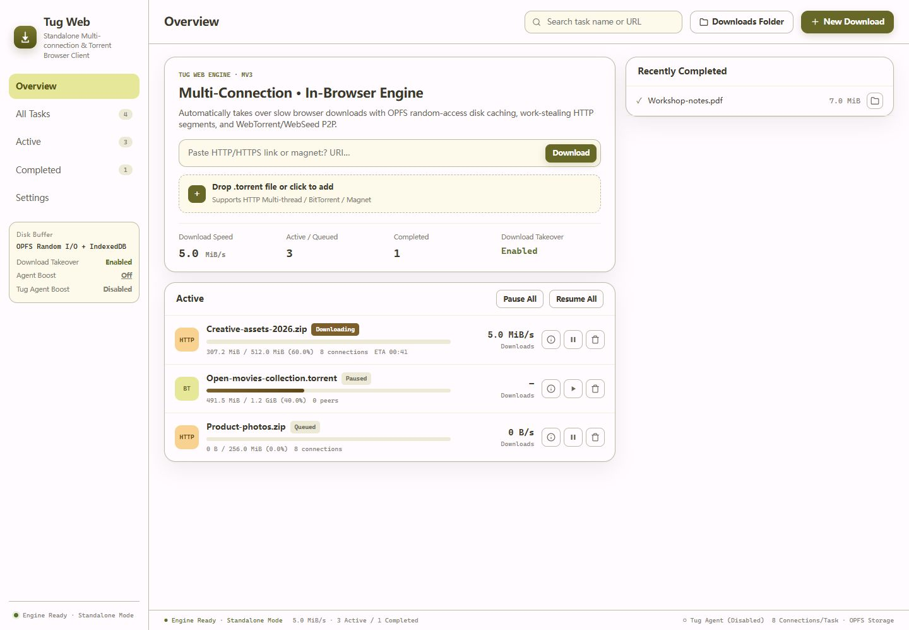
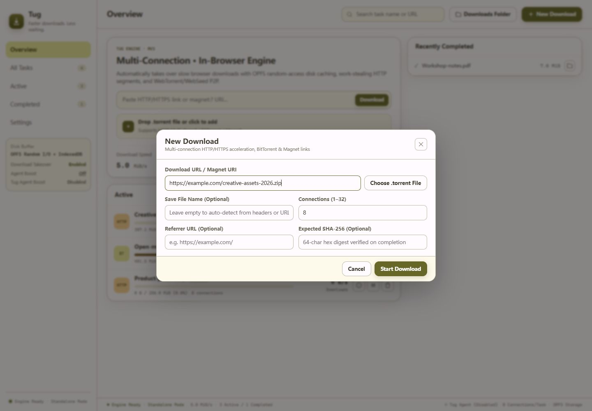
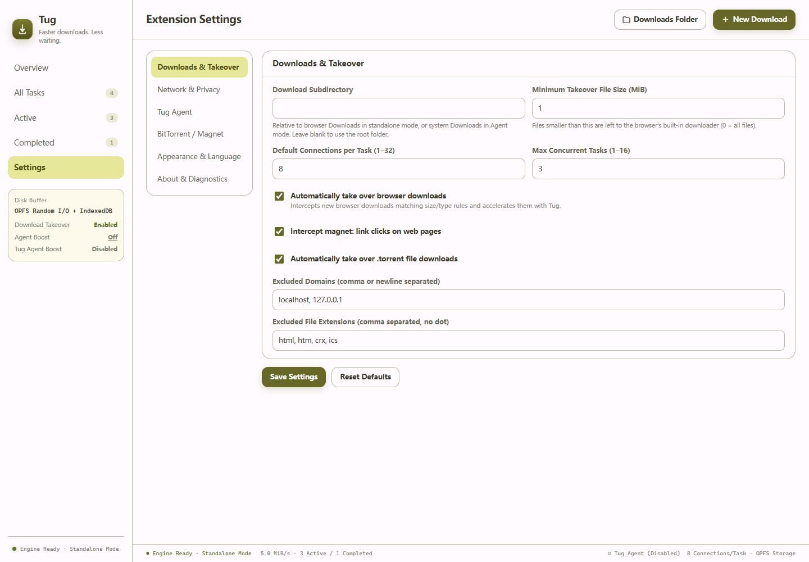

<h1 align="center">
   Tug Web
</h1>

<p align="center">浏览器里的下载工作台 · 多连接 · 断点续传 · BitTorrent / 磁力链接</p>
<p align="center">
  
  
  <a href="LICENSE"></a>
</p>
<p align="center"><b>简体中文</b> · <a href="README.en.md">English</a></p>
<p align="center"><a href="https://github.com/nanio-dev/Tug-Web/releases/tag/last">最新版本</a> · <a href="https://github.com/nanio-dev/Tug-Desktop">Windows 版</a> · <a href="https://github.com/nanio-dev/Tug-Android">Android 版</a></p>

Tug Web 是独立运行的 Chromium 浏览器下载扩展。在 Chrome、Edge 等兼容浏览器中集中管理下载，支持 HTTP/HTTPS 多连接、暂停续传、种子与磁力链接。无需安装 Tug Desktop，即可使用浏览器下载能力。

## 下载

| 文件 | 用途 |
|---|---|
| [浏览器扩展 CRX](https://github.com/nanio-dev/Tug-Web/releases/download/last/tug-web.crx) | CRX3 签名扩展包，安装方式取决于浏览器策略 |
| [Tug Agent · Windows x64](https://github.com/nanio-dev/Tug-Web/releases/download/last/tug-agent.exe) | 可选；补充传统 BT 连接、系统文件保存与定位能力 |
| [Tug Agent · macOS](https://github.com/nanio-dev/Tug-Web/releases/download/last/tug-agent-macos-universal.zip) | Intel / Apple Silicon 通用应用包 |
| [Tug Agent · Linux x64](https://github.com/nanio-dev/Tug-Web/releases/download/last/tug-agent-linux-x64.tar.gz) | 解压后运行 `sh install.sh`，无需 sudo |
| [Tug Agent · Linux ARM64](https://github.com/nanio-dev/Tug-Web/releases/download/last/tug-agent-linux-arm64.tar.gz) | 解压后运行 `sh install.sh`，无需 sudo |
| [发布记录](https://github.com/nanio-dev/Tug-Web/releases/download/last/release.json) | 构建提交、时间与文件校验信息 |
| [SHA256SUMS.txt](https://github.com/nanio-dev/Tug-Web/releases/download/last/SHA256SUMS.txt) | 下载文件校验值 |

### 开始使用

1. 下载签名的扩展 CRX，并打开浏览器扩展管理页面。
2. 在支持手动 CRX 的浏览器中，按浏览器指引导入；是否允许安装取决于浏览器与管理策略。
3. Chrome 在 Windows/macOS 上限制非商店扩展，通常需要受管理的企业部署策略。开发者可从源码构建后，在开发者模式下加载 `dist/extension/`。
4. 将 Tug Web 固定到工具栏，通过弹出面板添加链接，或打开管理面板查看全部下载。

普通 HTTP/HTTPS 下载和兼容的 WebTorrent/WebSeed 任务可使用纯浏览器模式。需要连接传统 BT 的 TCP/UDP/DHT 节点，或使用系统文件导出与定位时，可按扩展内引导启用 **Tug Agent 辅助组件**。组件支持 Windows、macOS 和 Linux。

macOS 解压后打开 `Tug Agent.app`。当前应用未配置 Developer ID 签名/公证，首次启动可能需要在系统设置的「隐私与安全性」中允许。Linux 解压后以桌面用户运行 `sh install.sh`；支持原生安装的 Chromium 系浏览器，Snap/Flatpak 浏览器的 Native Messaging 沙箱桥接暂不支持。后续连接与 120 秒空闲退出均自动处理，不安装开机常驻服务。

常驻目录为 Windows `%LOCALAPPDATA%\TugAgent`、macOS `~/Library/Application Support/TugAgent`、Linux `${XDG_DATA_HOME:-~/.local/share}/tug-agent`。下载使用系统 Downloads（Linux 优先通过 `xdg-user-dir DOWNLOAD` 获取），不读取浏览器私有配置。卸载入口清理用户目录与本程序注册的 Native Messaging 清单。

## 截图

| 下载总览 | 添加下载 |
|---|---|
|  |  |



## 功能

- **多连接下载**：HTTP/HTTPS 分段下载，可配置连接数、并发任务与全局限速。
- **可靠续传**：暂停、继续、重试，以及 Range、ETag / Last-Modified 校验；服务器不支持分段时使用单流。
- **BitTorrent / Magnet**：种子文件、磁力链接、WebTorrent/WebSeed、文件选择与逐 Piece 校验；辅助组件扩展传统 BT 连接能力。
- **任务管理**：总览、全部任务、未完成与已完成，支持搜索、筛选、排序与批量操作。
- **浏览器集成**：下载接管、右键菜单、磁力链接捕获，以及临时绕过接管。
- **界面与偏好**：工具栏面板、完整管理页、浅色/深色主题，简体中文、繁體中文、English、日本語、한국어。
- **本地保存**：下载状态和缓存保存在当前浏览器配置中；清理浏览器数据可能影响未完成任务，请先保存需要的文件。

实际并发取决于浏览器网络栈及服务器支持，配置连接数不等于任意源站的有效连接数。

## 从源码构建

需要 Node.js 22+；构建 Windows 辅助组件还需要 Rust MSVC 工具链及 C++ Build Tools。

```powershell
npm ci
npm run check
npm test
npm run build
```

Windows 可双击 `build.bat` 构建扩展，产物为 `dist/extension/`（`dist/` 也可加载）。

双击 **`packer.bat`** 会依次构建正式扩展与辅助组件，并在 `out/` 中生成：

| 文件 | 内容 |
|---|---|
| `tug-web.crx` | 正式签名的 CRX3 / Manifest V3 扩展 |
| `tug-agent.exe` | Windows Release 辅助组件 |
| `tug-agent-macos-universal.zip` | macOS Intel / Apple Silicon 通用应用 |
| `tug-agent-linux-x64.tar.gz`、`tug-agent-linux-arm64.tar.gz` | Linux 安装包 |
| `release.json` | 版本、构建提交、文件大小与 SHA-256 |
| `SHA256SUMS.txt` | 校验值文本 |

签名私钥首次生成在本地 `.local/tug-web-signing.pem`，后续打包会复用以保持扩展 ID。请备份私钥；它不会进入 Git 或 `out/`。也可通过 `TUG_EXTENSION_SIGNING_KEY` 指定已有私钥。

Mac/Linux 产物在 GitHub Actions 的原生环境构建并运行测试。打包需要已登录 GitHub CLI，自动获取与 Agent 源码提交匹配的成功构建产物；缺失或失败时停止发布。Mac/Linux 本地构建可运行 `sh agent/build.sh`。后续统一通过 `web/push.bat --no-pause` 构建、打包、上传和校验。

命令行可加 `--no-pause`。任一步骤失败都会返回非零退出码。打包不包含内部文档、网站源码、截图或测试资源。扩展更新后请到扩展页面点击“重新加载”；辅助组件可随扩展一起更新。

## 开发与反馈

| 目录 | 内容 |
|---|---|
| `src/` | 扩展界面、浏览器集成与下载引擎 |
| `agent/` | Windows / macOS / Linux 辅助组件源码 |
| `public/` | 扩展运行资源、对外截图与资料 |
| `scripts/`、`tests/` | 构建、测试与验证工具 |

```powershell
npm run test:browser
npm run test:agent
```

发现问题可提交 [Issue](https://github.com/nanio-dev/Tug-Web/issues)。

## 许可证

[Apache License 2.0](LICENSE)。
