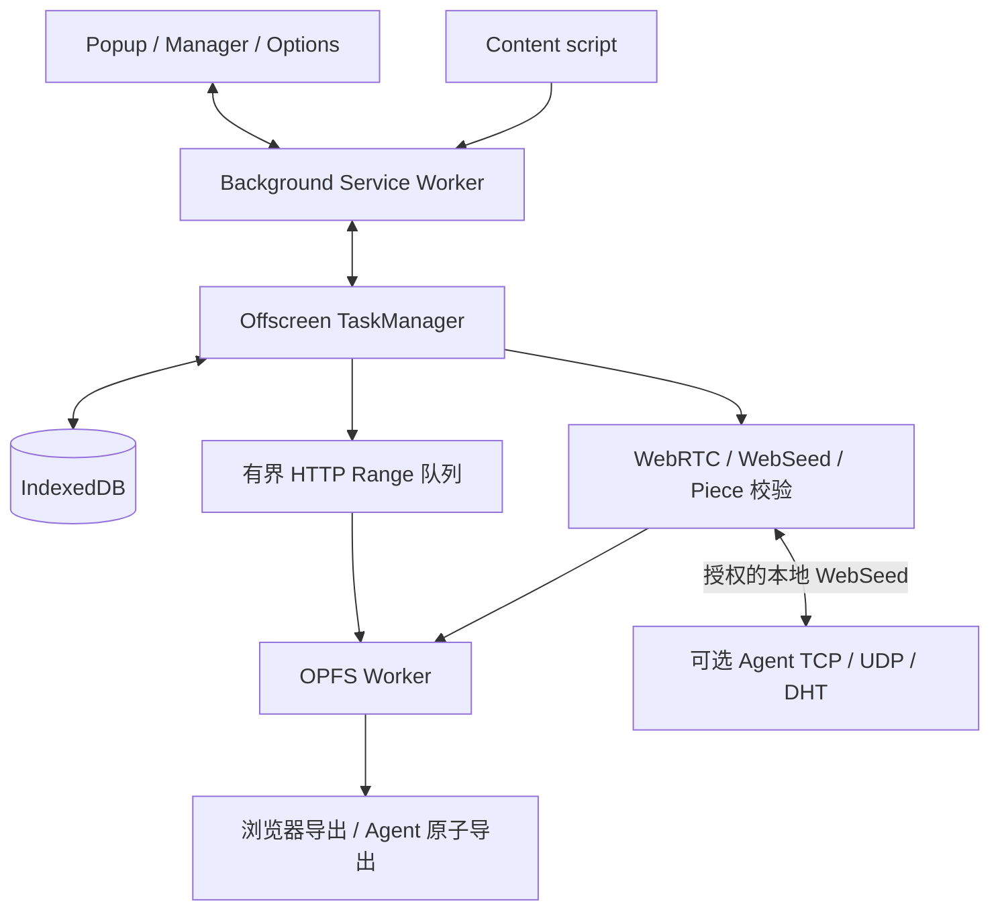

# 架构与数据提交约定

## 职责

Tug Web 与 Desktop、Android 独立。插件拥有唯一的任务数据库、队列、设置和恢复决策，不启动 Desktop，不在 Agent 中创建第二套任务数据库。

Service Worker 管理下载接管、右键、DNR 请求头、原生配对和系统下载 API；Offscreen 承载实际任务。关闭 Popup 不会停止引擎；浏览器或引擎上下文销毁后从持久化检查点恢复。

## HTTP

1. `GET Range: bytes=0-0` 探测资源与验证器。
2. 初始 200 使用单流；206 必须具有合法、吻合探测区间的 Content-Range；只有 `416 bytes */0` 表示空资源。
3. 创建均衡的有界工作队列，避免切割已排队/已发出的请求。明文 HTTP 或已识别的 HTTP/1.1 限制为最多六个工作者；HTTPS/HTTP/2 保留配置并发。
4. 分片必须是吻合请求的 206，携带 If-Range，检查总长、实际字节数和响应 ETag。中途资源变化明确失败；可恢复网络错误从已确认位置重试。
5. 每个工作者复用 2 MiB 缓冲。网络空闲超时不包含写盘背压与主动限速等待。
6. 单个工作者失败会取消整组；所有工作者结束后才返回给暂停/删除操作，不遗留写入。

没有强 ETag 或可用 Last-Modified 的资源不复用旧字节。SHA-256 使用增量实现；校验不匹配时失效续传位置，重试不会直接导出已知错误的数据。

## 存储与恢复

- `allocate(..., "reset")` 清空旧文件；`preserve` 仅打开/创建，不能误清除续传数据。
- 下载进度与可续传位置分离。网络已接收的数据可显示在 UI；只有写入 ACK 后再成功 sync 的区间才进入 committedSegments。
- 先提交文件数据，再提交 IndexedDB。WritableFileStream 回退模式通过 close 提交；SyncAccessHandle 的 sync 不关闭句柄。
- flush/写入/配额/权限失败会传播。已经工作的 Worker 崩溃后不悄悄降级并假装同步成功，需要重新加载扩展再恢复。
- HTTP 的 `httpCheckpointVersion` 与 `httpDownloadComplete` 区分安全位置和已完成校验的缓存。旧版不可信的检查点不复用。
- IndexedDB 写入串行化，最终状态等待此前快照。持久化失败会显示失败，避免将数据库中仍为 queued 的旧记录无限重启。

## BT 与逐文件保存

Piece 完整校验后才写入选中文件，再周期性同步并提交完成位图。暂停/失败前提交安全状态。新增勾选文件使相关跨文件 Piece 失效；缺失/过短的缓存也使相应标记失效。

`btExports` 按文件记录下载 ID/系统路径；多文件保存失败只重试尚未完成的项目。已经导出的缓存不在中途删除，任务完成状态持久化后才清理。缓存缺失不能被当作已下载的全零文件导出。

## Agent 边界

Agent 当前提供 BT 协议网关、导出和文件打开/删除，不提供 HTTP 源站加速。HTTP 数据仍先进入 OPFS，再导出系统目录。

协议 2 的能力凭据通过 Native Messaging 交付，HTTP 仅验证凭据。文件操作限制在实际 Downloads 根目录内，导出拒绝链接目录和目录穿越。先写同目录临时文件并 sync，再不覆盖地发布最终文件。

原生 HTTP 数据通道仍是后续架构选项：需要由插件指定区间、Agent 回报已提交字节，并明确文件归属和取消/恢复协议；不得引入另一套持久化下载队列。
